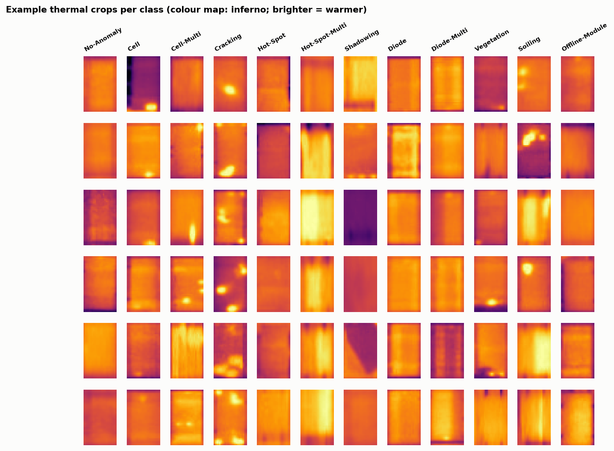
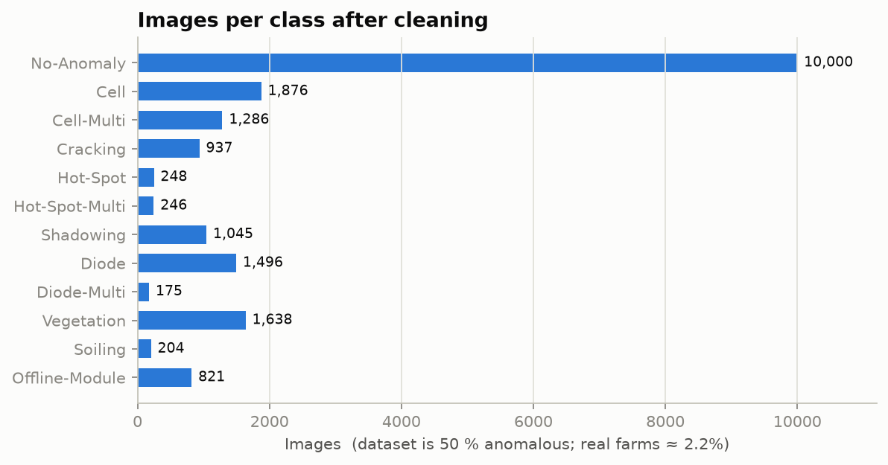
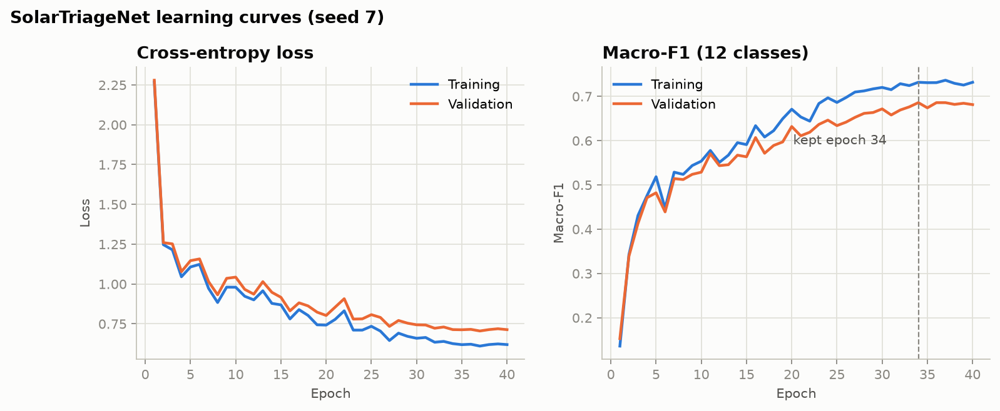
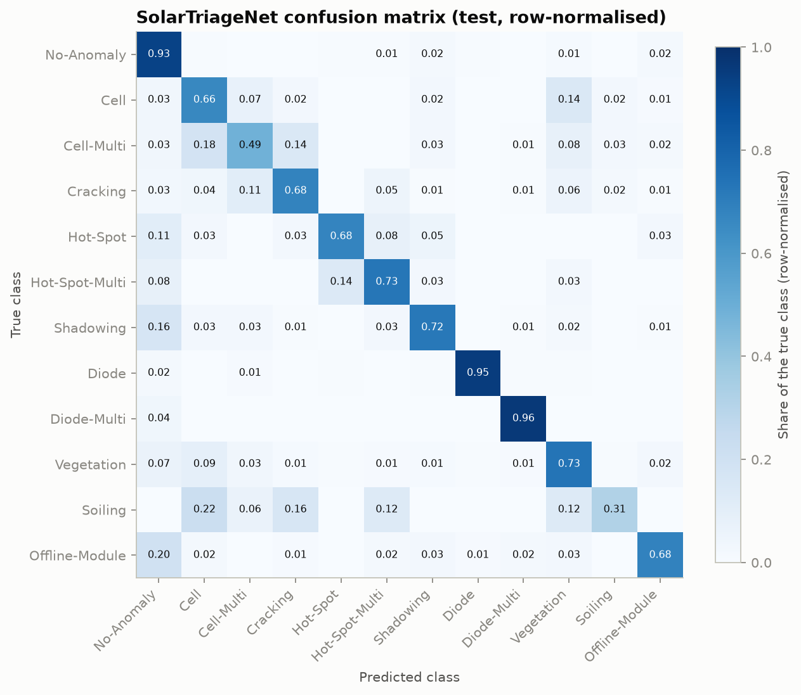
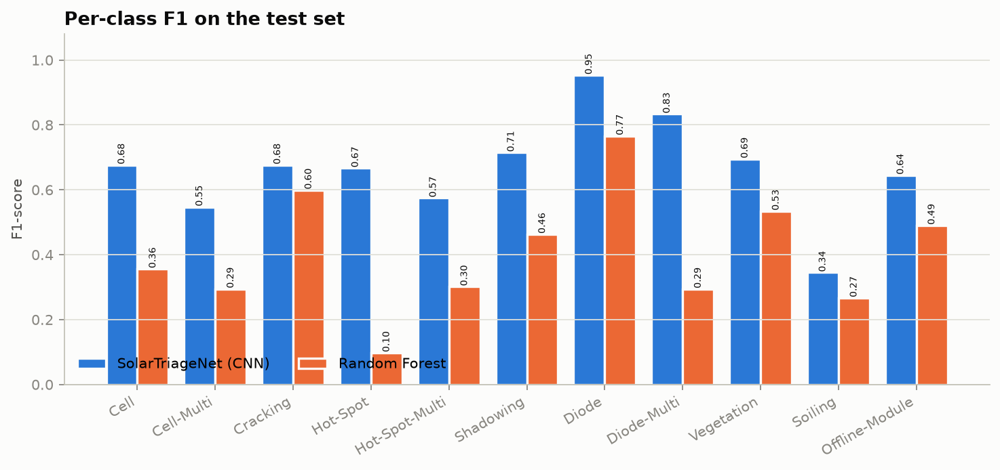
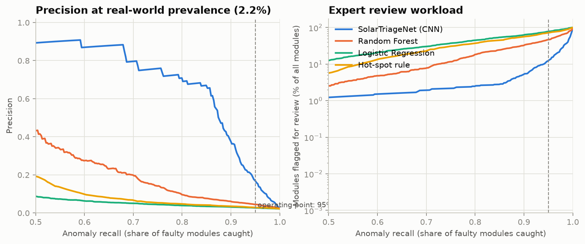
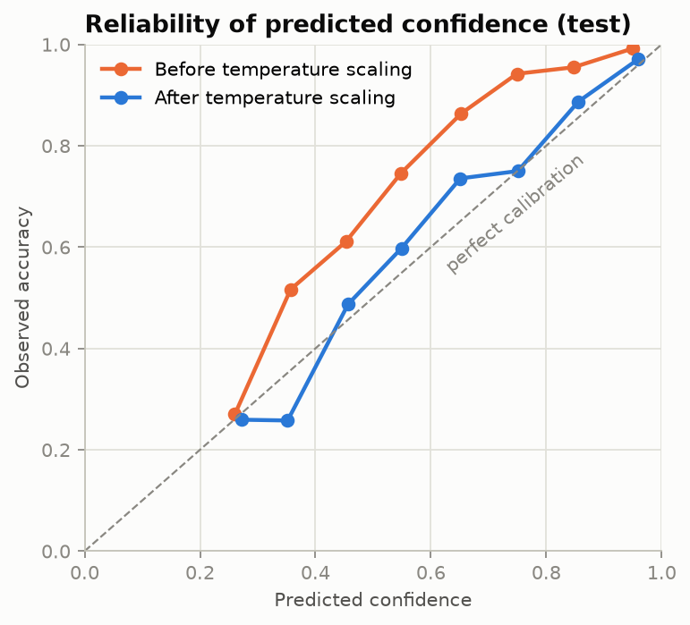
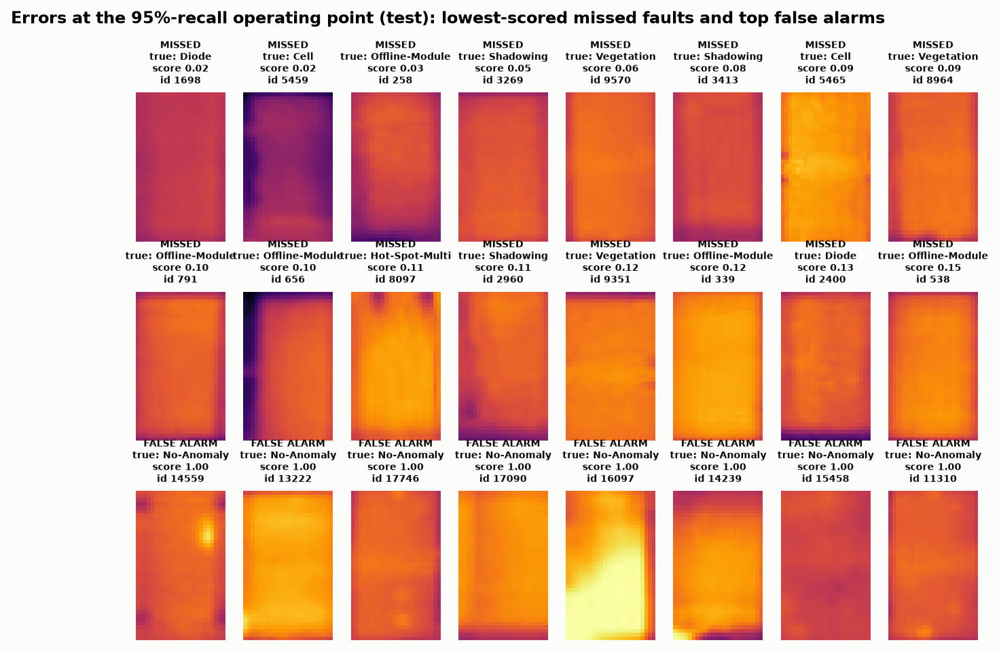
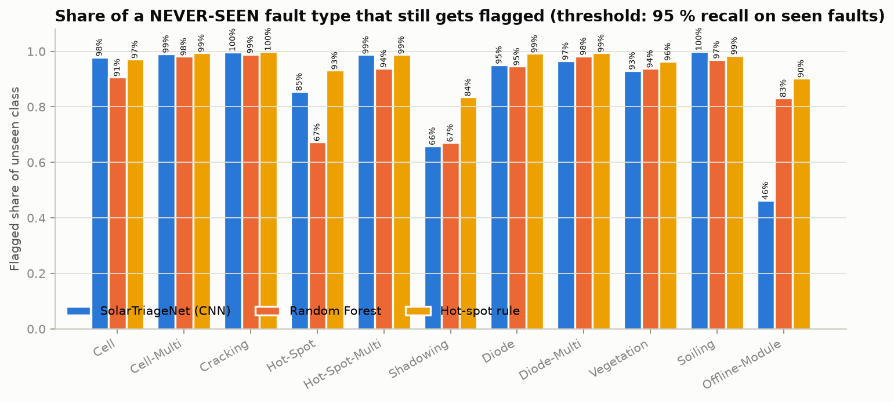

# SolarTriage: Workload-Aware Deep-Learning Triage of Aerial Thermal Images of Solar Modules

| | |
|---|---|
| Document | Internship Technical Report |
| Subtitle | Deep Learning & Neural Network Application Program |
| Submitted by | Aaditya Bairagi |
| Roll Number | 0834AL241001 |
| Course | B.Tech Computer Science & Engineering (AI/ML) |
| Institute | Sushila Devi Bansal College of Engineering, Indore |
| Department | Department of Computer Science & Engineering (AI/ML) |
| Assignment | Deep Learning & Neural Network Application Program |
| Maximum Marks | 85 |
| Submission Date | 26 October 2026 |
| Code Repository | https://github.com/Adityabairagi21/solar-ir-triage |
| Running Header | SolarTriage: deep-learning triage of solar thermal images |

<!-- BODY -->

# Abstract

Aerial infrared inspection of solar farms produces one thermal crop per module, and trained analysts still decide which crops show a fault. On a real farm only about 2.2 % of modules are anomalous, so most of that effort is spent on healthy modules. This report presents SolarTriage, a compact residual convolutional neural network (SolarTriageNet, 299,148 parameters, 1.2 MB) that classifies 24 × 40-pixel crops from the public InfraredSolarModules dataset into 12 classes and derives a triage score from the same output. The data pipeline removes exact duplicates with conflicting labels and keeps near-duplicates inside one split. On the held-out test set the network reaches a macro-F1 of 0.688 (95 % CI 0.662–0.715) against 0.441 for a Random Forest, and a ROC-AUC of 0.979 for anomaly vs. healthy. At an operating point fixed on validation data to catch 95 % of faults, it caught 96.1 % of test faults and, projected to 2.2 % prevalence, would send 16.7 % of all modules to an expert, compared with 47.9 % for the Random Forest and 74.1 % for a hot-spot rule. Temperature scaling reduced the expected calibration error from 0.150 to 0.030. A leave-one-fault-type-out experiment shows the limits of the approach: never-seen fault types were flagged in 88.9 % of cases on average, but only 46 % of Offline-Module and 66 % of Shadowing crops. A Streamlit application runs the model on a laptop CPU at about 1.2 ms per image.

**Keywords:** solar photovoltaics, infrared thermography, convolutional neural network, class imbalance, triage, open-set evaluation, calibration

\pagebreak

[[TOC]]

\pagebreak

# 1. Introduction and Background

Solar photovoltaic (PV) capacity is growing fast, and every installed module has to keep producing the power its owner expects. Modules degrade and fail for many reasons: cracked cells, failing bypass diodes, wiring faults that take a whole module offline, dirt, vegetation and shading. Many of these faults change how heat is distributed across a module, so they become visible in infrared (thermal) images. The industry has standardised aerial thermography for this purpose (IEC TS 62446-3:2017, cited by Millendorf et al., 2020): drones or piloted aircraft photograph entire farms with thermal cameras, the images are split into one crop per module, and trained analysts decide which crops show a fault and what kind.

That last step is the bottleneck this project addresses. In the words of the dataset authors at Raptor Maps, "Currently, trained experts are required to analyze this data. The authors seek to automate this process with machine learning to allow experts to focus on restoring power production, rather than manually searching through imagery" (Millendorf et al., 2020).

# 2. Problem Statement

Given a 24 × 40-pixel thermal crop of one solar module, decide whether a human expert needs to look at it (**flag** or **clear**), and if so, suggest the most likely fault type. The decision must catch a pre-agreed share of faulty modules (here 95 %) while sending as few healthy modules as possible to the expert. It must also be evaluated under the conditions of a real farm, where only about **2.2 %** of modules are anomalous (Millendorf et al., 2020, citing the Raptor Maps global inspection report).

# 3. Motivation and Real-World Significance

- **Expert time is the scarce resource.** At 2.2 % prevalence, an analyst who reviews every crop spends about 98 % of the effort on healthy modules. A triage model that clears most healthy modules automatically, while keeping recall high, directly reduces that effort.
- **Accuracy on a balanced test set is the wrong yardstick.** The public dataset is about 50 % anomalous by design, so a model with "90 % accuracy" can still produce many false alarms for every real fault on a real farm. This project therefore reports precision and workload **at the real prevalence**.
- **New fault types appear in the field.** A triage model that only recognises the fault types it was trained on would silently clear an unfamiliar fault. We test this explicitly.
- **Edge deployment.** The dataset authors list "real-time classification that can be used by low performance edge-computing devices" as a goal. A small CNN that runs on a laptop CPU fits this goal.

# 4. Related Work and Existing Solutions

**The dataset.** Millendorf, Obropta and Vadhavkar (2020) released InfraredSolarModules: 20,000 infrared crops of 24 × 40 pixels in 12 classes, collected by piloted aircraft and drones and labelled by Raptor Maps experts with the help of visible-spectrum images. They highlight the class imbalance in PV anomaly detection and propose benchmarking, open-set recognition of anomalies outside the 12 classes, and edge deployment as future milestones.

**Classification results on this dataset.** Corley et al. (2025) summarise several published results: a NASNet + LSTM model at 85 %, a cascading ensemble at 88 %, a custom CNN at 92.5 %, and an EfficientNet-B0 + SVM at 93 % (the last on "a dataset of 20k solar panel crops"). They also show that a plain **Random Forest reaches 84.0 %** overall accuracy. They argue that crop-level classification is limited, because experts compare a module with its neighbours, which a single crop cannot show. Our literature search found further CNN papers on this dataset reporting a wide range of accuracies. It also indicated that some high scores come from augmentation or oversampling applied before the train/test split; we could not verify every paper in full, so this is noted as a risk rather than a finding.

**Unseen anomalies and domain shift.** Bommes et al. (2021) study unsupervised domain adaptation between PV plants and the detection of unknown anomaly types, using a large private dataset of 2.92 million IR images (8.5 % anomalous). Their data is not public.

**Rule-based tools.** Classical thermography flags a module when its hottest region is much warmer than the rest. This is simple and transparent, but it cannot separate electrical faults from shading, soiling or vegetation, and it has no notion of fault type.

**Commercial platforms** combine proprietary models with human analysts. They cannot be evaluated or reproduced publicly.

# 5. Research Gap

In our search we did not find a public, reproducible study on InfraredSolarModules that (i) fixes the operating point in advance and reports **analyst workload, precision, false alarms and missed faults at the real-world 2.2 % prevalence**; (ii) tests whether the detector still flags a **fault type that was absent from training**; and (iii) documents a **leakage-controlled split** that removes duplicates with conflicting labels and keeps near-duplicates within one split. This project addresses these three points. It does not claim to be the first model for this dataset or to set a new accuracy record.

# 6. Objectives and Scope

**Objectives**

1. Build a leakage-controlled data pipeline for InfraredSolarModules, including duplicate analysis.
2. Design and train a compact CNN (SolarTriageNet) that outputs calibrated fault-type probabilities and an anomaly score.
3. Compare it fairly with a hot-spot rule, logistic regression and a Random Forest on identical splits.
4. Evaluate in deployment terms at 2.2 % prevalence: workload, precision and errors per 10,000 modules at a validation-chosen 95 % recall operating point.
5. Test robustness to unseen fault types with a leave-one-fault-type-out experiment.
6. Deliver a working Streamlit demonstration that uses the trained model.

**Scope.** In scope: crop-level classification and triage, CPU-only training, and a public dataset. Out of scope: detecting modules in full drone images, fusing visible and thermal imagery, splitting by site (no site identifiers exist), and field validation.

# 7. Dataset

| Property | Value |
|---|---|
| Name and source | InfraredSolarModules, Raptor Maps: https://github.com/RaptorMaps/InfraredSolarModules |
| Licence | MIT (Copyright 2020 Raptor Maps, Inc.) |
| Download | 15.5 MB zip; SHA-256 b82c706b…5b5e, verified by `scripts/prepare_data.py` |
| Images | 20,000 single-channel JPEGs, 24 px wide × 40 px tall, one module per image |
| Classes | 11 anomaly classes + No-Anomaly (10,000 images) |
| Collection | Piloted aircraft and drones with mid- or long-wave infrared cameras; 3–15 cm per pixel (paper) |
| Labels | Expert labels in `module_metadata.json` |

Table 1: Dataset summary.

| Class | Description (dataset authors) | Images (raw) | Images (after cleaning) |
|---|---|---|---|
| No-Anomaly | Healthy module | 10,000 | 10,000 |
| Cell | Hot spot on a single cell, square geometry | 1,877 | 1,876 |
| Cell-Multi | Hot spots on several cells | 1,288 | 1,286 |
| Cracking | Module anomaly caused by surface cracking | 940 | 937 |
| Hot-Spot | Hot spot on a thin-film module | 249 | 248 |
| Hot-Spot-Multi | Several hot spots on a thin-film module | 246 | 246 |
| Shadowing | Sunlight blocked by vegetation, structures or nearby rows | 1,056 | 1,045 |
| Diode | Activated bypass diode, typically one-third of the module | 1,499 | 1,496 |
| Diode-Multi | Several activated bypass diodes | 175 | 175 |
| Vegetation | Panels blocked by vegetation | 1,639 | 1,638 |
| Soiling | Dirt, dust or other debris on the surface | 204 | 204 |
| Offline-Module | The entire module is heated | 827 | 821 |
| **Total** | | **20,000** | **19,972** |

Table 2: Classes and image counts. Descriptions follow Millendorf et al. (2020).



**Limitations of the data.** There are no site, flight or date identifiers, so a split by site is impossible. Pixel values are 8-bit intensities with unknown radiometric scaling, not temperatures. The released counts differ slightly from those printed in the paper (for example Cracking 940 vs 941). The class mix (50 % anomalous) differs strongly from real farms (about 2.2 %).

# 8. Data Preprocessing and Exploratory Analysis

## 8.1 Integrity checks and duplicates

Each image was hashed (MD5 of the pixel array). **22 groups of exact duplicates** were found. In **6 groups the copies carry different labels**: identical pixels labelled, for example, both Cracking and Offline-Module. These 12 images were removed as label noise. Of the remaining duplicates, one copy was kept (16 images removed).

Near-duplicates were detected with a 64-bit difference hash (dHash) combined with the mean absolute pixel difference. The thresholds were checked empirically. With loose thresholds (mean difference ≤ 10 grey levels), unrelated images chained into a single group of 9,679 images, because these small crops are low in texture. The final, strict rule (Hamming distance ≤ 4 **and** mean difference ≤ 3) links 422 pairs of images into 144 groups containing 439 images (largest group: 29 images). In 16 of these pairs the two images carry different labels, which again indicates some label noise. Near-duplicates were not removed; instead, each group is assigned to one split, so the model is never tested on a near-copy of a training image.

| Step | Images |
|---|---|
| Raw images | 20,000 |
| Removed: exact duplicates with conflicting labels (6 groups) | −12 |
| Removed: extra copies of exact duplicates with the same label | −16 |
| **Clean images used** | **19,972** |
| Near-duplicate groups kept together in one split | 144 groups, 439 images |

Table 3: Data cleaning summary.

## 8.2 Split

A `StratifiedGroupKFold` with 20 folds (seed 42) assigns 3 folds to test, 3 to validation and 14 to training. This gives **70 / 15 / 15 %** with the class proportions preserved and no near-duplicate group crossing splits (checked by an assertion and a unit test).

| Class | Train | Validation | Test |
|---|---|---|---|
| No-Anomaly | 7,015 | 1,497 | 1,488 |
| Cell | 1,316 | 279 | 281 |
| Cell-Multi | 899 | 196 | 191 |
| Cracking | 657 | 141 | 139 |
| Hot-Spot | 173 | 38 | 37 |
| Hot-Spot-Multi | 174 | 35 | 37 |
| Shadowing | 732 | 155 | 158 |
| Diode | 1,050 | 222 | 224 |
| Diode-Multi | 122 | 27 | 26 |
| Vegetation | 1,147 | 246 | 245 |
| Soiling | 141 | 31 | 32 |
| Offline-Module | 575 | 130 | 116 |
| **Total** | **14,001** | **2,997** | **2,974** |

Table 4: Images per class and split.



## 8.3 Preprocessing

Pixels are scaled to [0, 1] and standardised with the mean and standard deviation of the **training split only**. These two numbers are stored in the model file and reused at inference. Augmentation is applied **only to training batches, after the split**: random horizontal and vertical flips, shifts of up to 2 pixels (edge-replicated), and ±10 % brightness and contrast changes. These are changes a different flight, camera gain or module orientation could plausibly produce. Rotations by 90° were not used because module crops are portrait-shaped.

## 8.4 Class imbalance

Class sizes range from 175 (Diode-Multi) to 10,000 (No-Anomaly). Instead of oversampling, which risks duplicating training images and is easy to apply before the split by mistake, the loss is weighted by the square root of the inverse class frequency. This gives a moderate weight increase for rare classes without letting a few rare images dominate training. Label smoothing (0.05) reduces over-confidence.

# 9. Proposed Methodology

```
download + SHA-256 check -> safe extraction -> duplicate analysis -> group-stratified 70/15/15 split
   -> baselines (hot-spot rule, logistic regression, Random Forest)      [same split]
   -> SolarTriageNet x 3 seeds, early stopping on validation macro-F1
   -> choose deployed seed on VALIDATION macro-F1
   -> temperature scaling + triage thresholds fitted on VALIDATION
   -> single evaluation on TEST: 12-class metrics, triage at 2.2 % prevalence,
      calibration, bootstrap confidence intervals, error analysis
   -> leave-one-fault-type-out experiment (11 retrainings)
   -> Streamlit demo using the saved model
```

**Triage decision.** The network outputs 12 class probabilities. The anomaly score is s = 1 − P(No-Anomaly). A module is flagged when s ≥ t, where t is the largest threshold that reaches 95 % anomaly recall on the **validation** set. Thresholds for 90, 98 and 99 % recall are also stored, so the user can choose a different trade-off in the demo.

**Deployment view.** For a threshold with true-positive rate TPR and false-positive rate FPR, measured per class group on the test set, and real-world prevalence π = 0.022:

- review workload W = π·TPR + (1 − π)·FPR (the share of all modules sent to an expert);
- precision at prevalence = π·TPR / W;
- missed faults per 10,000 modules = 10,000·π·(1 − TPR);
- false alarms per 10,000 modules = 10,000·(1 − π)·FPR.

This assumes that the score distributions of healthy and of faulty modules are the same in the field as in the dataset, and that only their proportion changes. Section 18 discusses this assumption.

# 10. Neural Network Architecture

| Stage | Layers | Output (C × H × W) |
|---|---|---|
| Input | single-channel thermal crop, standardised | 1 × 40 × 24 |
| Stage 1 | ResBlock(1→32): 2 × [Conv 3×3, BatchNorm, ReLU] + 1×1 projection skip; MaxPool 2×2 | 32 × 20 × 12 |
| Stage 2 | ResBlock(32→64); MaxPool 2×2 | 64 × 10 × 6 |
| Stage 3 | ResBlock(64→128); MaxPool 2×2 | 128 × 5 × 3 |
| Head | Global average pooling, Dropout 0.3, Linear 128→12 | 12 logits |

Table 5: SolarTriageNet architecture (299,148 trainable parameters).

**Why this design.**

- The inputs are tiny (960 pixels). Three 2× poolings reduce 40 × 24 to 5 × 3, and a fourth would leave almost no spatial layout, so the network is deliberately shallow but wide enough (up to 128 channels) to represent 11 fault patterns.
- 3 × 3 convolutions detect local hot cells and edges; stacking them gives a receptive field that covers strip-shaped patterns such as an activated bypass diode (about one-third of the module).
- Residual connections and batch normalisation make training from scratch stable on about 14,000 images. Pretrained ImageNet networks expect RGB photographs at much larger resolution and would have to upsample 24 × 40 crops by about 10×.
- Global average pooling instead of a large fully connected layer keeps the parameter count low and reduces overfitting.
- One softmax head serves both purposes: the class probabilities give the fault type, and 1 − P(No-Anomaly) gives the triage score.

# 11. Training Configuration and Implementation

| Setting | Value |
|---|---|
| Framework | PyTorch 2.14.1 (CPU), scikit-learn 1.7.2 for baselines |
| Hardware | Laptop CPU, 14 threads; no GPU |
| Loss | Cross-entropy with sqrt-inverse-frequency class weights, label smoothing 0.05 |
| Optimiser | AdamW, learning rate 0.002, weight decay 1e-4 |
| Schedule | Cosine annealing over 40 epochs |
| Batch size | 128 |
| Early stopping | Patience 8 epochs on validation macro-F1; best epoch restored |
| Seeds | 42, 7, 2024 (deployed model chosen by validation macro-F1) |
| Calibration | Temperature scaling fitted on validation negative log-likelihood |
| Reproducibility | All settings in `configs/default.yaml`; seeds fixed for Python, NumPy and PyTorch |

Table 6: Training configuration.

**Baselines (same split).**

- **Hot-spot rule:** score = 99th percentile − median intensity; binary only.
- **Logistic regression:** standardised raw pixels; C chosen from {0.01, 0.1, 1} on validation macro-F1.
- **Random Forest:** 300 trees with balanced class weights on raw pixels plus 6 summary statistics and row and column mean profiles; min_samples_leaf from {1, 3} chosen on validation.

On validation macro-F1, logistic regression selected C = 0.1 (0.237) and the Random Forest selected min_samples_leaf = 3 (0.433). The test set was not used for any of these choices.

# 12. Experimental Design and Evaluation Metrics

| Question | Metric(s) | Data |
|---|---|---|
| How well are fault types recognised? | Accuracy, balanced accuracy, macro-F1, per-class precision, recall and F1, confusion matrix | Test |
| How well are faulty modules separated from healthy ones? | ROC-AUC; average precision at 50 % and at 2.2 % prevalence | Test |
| What does it mean on a real farm? | At the validation-chosen 95 % recall threshold: recall, workload, precision at 2.2 %, false alarms and missed faults per 10k | Test |
| How certain are the results? | 95 % bootstrap intervals (1,000 class-stratified resamples), paired CNN − RF differences, 3 training seeds | Test |
| Are probabilities trustworthy? | Expected calibration error (ECE), reliability diagram | Test |
| Does it catch unseen fault types? | Flagged share of a held-out class (leave-one-fault-type-out) | All images of that class |
| Is it deployable on small hardware? | Parameters, file size, CPU latency per image | — |

Table 7: Experimental design. Macro-F1 is the main 12-class metric because accuracy is dominated by the No-Anomaly class.

# 13. Results

All numbers in this section come from a single evaluation on the test set (2,974 images), after every model choice, the temperature and all thresholds had been fixed on the validation set.

## 13.1 Training and seed stability

| Seed | Best epoch | Val macro-F1 | Test accuracy | Test macro-F1 | Test ROC-AUC | Training time |
|---|---|---|---|---|---|---|
| 42 | 31 | 0.678 | 0.797 | 0.661 | 0.976 | 28.4 min |
| 7 (deployed) | 34 | 0.686 | 0.815 | 0.688 | 0.979 | 15.0 min |
| 2024 | 36 | 0.676 | 0.813 | 0.688 | 0.980 | 14.4 min |
| **Mean ± SD** | | | 0.808 ± 0.010 | 0.679 ± 0.016 | 0.978 ± 0.002 | |

Table 8: The three training runs. The deployed model is the seed with the highest **validation** macro-F1 (seed 7). Seed 42 took longer because it shared the CPU with another job; the other seeds took about 15 minutes each.

The spread between seeds is small (macro-F1 standard deviation 0.016), so the comparison with the baselines below is not an artefact of one lucky run. Early stopping picked epochs 31–36 of 40, and the gap between training and validation macro-F1 stayed below about 0.06 (Figure 3).



## 13.2 Fault-type recognition (12 classes)

| Model | Accuracy | Balanced accuracy | Macro-F1 | Weighted F1 |
|---|---|---|---|---|
| **SolarTriageNet (CNN)** | 0.815 | 0.710 | **0.688** | 0.815 |
| Random Forest | 0.685 | 0.403 | 0.441 | 0.652 |
| Logistic Regression | 0.327 | 0.343 | 0.248 | 0.368 |

Table 9: 12-class test results.

The CNN improves macro-F1 by 0.247 over the Random Forest. The paired bootstrap interval of this difference is 0.214 to 0.281, which excludes zero. The CNN's overall accuracy (81.5 %) is below the 84.0 % that Corley et al. (2025) report for a Random Forest and well below the 85–93 % reported for other CNNs. Our numbers are not directly comparable: the split here removes conflicting duplicates and keeps near-duplicates together, and our Random Forest, evaluated the same way, reaches only 68.5 %. We therefore make no claim about state-of-the-art accuracy.

| Class | Test images | CNN precision | CNN recall | CNN F1 | RF F1 |
|---|---|---|---|---|---|
| No-Anomaly | 1488 | 0.934 | 0.927 | 0.930 | 0.832 |
| Cell | 281 | 0.691 | 0.662 | 0.676 | 0.356 |
| Cell-Multi | 191 | 0.624 | 0.487 | 0.547 | 0.295 |
| Cracking | 139 | 0.676 | 0.676 | 0.676 | 0.599 |
| Hot-Spot | 37 | 0.658 | 0.676 | 0.667 | 0.098 |
| Hot-Spot-Multi | 37 | 0.474 | 0.730 | 0.574 | 0.301 |
| Shadowing | 158 | 0.708 | 0.722 | 0.715 | 0.463 |
| Diode | 224 | 0.955 | 0.951 | 0.953 | 0.766 |
| Diode-Multi | 26 | 0.735 | 0.962 | 0.833 | 0.294 |
| Vegetation | 245 | 0.659 | 0.735 | 0.695 | 0.534 |
| Soiling | 32 | 0.385 | 0.312 | 0.345 | 0.267 |
| Offline-Module | 116 | 0.612 | 0.681 | 0.645 | 0.490 |

Table 10: Per-class test results of the deployed CNN, with the Random Forest F1 for comparison.





The CNN has a higher F1 than the Random Forest on all 12 classes. Soiling remains weak for both (CNN F1 0.345 vs. 0.267), and with only 32 test images it is also the least reliable estimate. Diode faults are recognised almost perfectly (F1 0.953), because an activated bypass diode produces a large, regular warm strip. The hardest classes are Soiling and Cell-Multi (F1 0.547).

## 13.3 Anomaly vs. healthy

| Model | ROC-AUC | Average precision (dataset, ~50 %) | Average precision (at 2.2 %) |
|---|---|---|---|
| SolarTriageNet (CNN) | 0.979 | 0.982 | 0.795 |
| Random Forest | 0.907 | 0.918 | 0.506 |
| Logistic Regression | 0.775 | 0.791 | 0.159 |
| Hot-spot rule | 0.823 | 0.848 | 0.350 |

Table 11: Binary separation on the test set. The last column re-weights the healthy test images so that anomalies make up 2.2 %.

The average precision drops sharply for every model when the test set is re-weighted to the real prevalence; this is the effect that a balanced-accuracy number hides. The CNN keeps the highest value (0.795).

## 13.4 Triage at the real-world prevalence

| Model | Test recall | False-positive rate | Review workload | Precision at 2.2 % | Missed faults / 10k | False alarms / 10k |
|---|---|---|---|---|---|---|
| **SolarTriageNet (CNN)** | 96.1 % | 14.9 % | **16.7 %** | 12.7 % | 8.6 | 1,459 |
| Random Forest | 95.5 % | 46.8 % | 47.9 % | 4.4 % | 9.9 | 4,581 |
| Logistic Regression | 93.9 % | 73.0 % | 73.4 % | 2.8 % | 13.5 | 7,138 |
| Hot-spot rule | 95.6 % | 73.7 % | 74.1 % | 2.8 % | 9.8 | 7,204 |

Table 12: All models at their own validation-chosen 95 % recall threshold, projected to 2.2 % prevalence.

At the planned operating point, the CNN caught 96.1 % of the test faults (bootstrap CI 95.1 %–97.0 %), so the threshold chosen on validation data transferred to the test set. On a farm with 2.2 % anomalies it would send **16.7 %** of all modules to an analyst (CI 14.9 %–18.5 %), an **83 % reduction** compared with reviewing every crop, and about a third of the Random Forest's workload (47.9 %; paired difference -34.1 % to -28.8 %). The hot-spot rule and logistic regression would still send about three-quarters of all modules for review.

The price of the high recall is low precision: only about 13 % of the flagged modules would actually be faulty. Table 13 shows the trade-off for the other stored thresholds, which the demo application lets the user choose.

| Target recall (validation) | Test recall | Review workload | Precision at 2.2 % | Missed / 10k | False alarms / 10k |
|---|---|---|---|---|---|
| 90 % | 90.8 % | 5.7 % | 34.8 % | 20.3 | 375 |
| 95 % | 96.1 % | 16.7 % | 12.7 % | 8.6 | 1,459 |
| 98 % | 98.6 % | 36.4 % | 6.0 % | 3.1 | 3,424 |
| 99 % | 99.3 % | 49.1 % | 4.4 % | 1.6 | 4,693 |

Table 13: CNN operating points (thresholds from validation, results on test).



## 13.5 Calibration

The network was under-confident before calibration, because of label smoothing and class weighting. Temperature scaling on the validation set found T = 0.69 (T < 1 sharpens the probabilities) and reduced the expected calibration error on the test set from 0.150 to **0.030** (Figure 7). The demo application therefore reports calibrated probabilities.



## 13.6 Efficiency

| Property | Value |
|---|---|
| Trainable parameters | 299,148 |
| Model file (weights, normalisation, temperature, thresholds) | 1.22 MB |
| CPU time per image, batch size 1 | 1.20 ms |
| CPU time per image, batch size 512 | 0.37 ms |
| Training time per seed (14-thread laptop CPU) | about 15 min |

Table 14: Size and speed (14 CPU threads). At this speed a farm of 100,000 modules is scored in under a minute on a laptop.

# 14. Error Analysis

**Most frequent confusions (test set, true → predicted).**

| True class | Predicted as | Images |
|---|---|---|
| Cell | Vegetation | 40 |
| Cell-Multi | Cell | 35 |
| No-Anomaly | Offline-Module | 34 |
| Cell-Multi | Cracking | 27 |
| Shadowing | No-Anomaly | 26 |
| No-Anomaly | Shadowing | 24 |
| Offline-Module | No-Anomaly | 23 |
| Vegetation | Cell | 22 |

Table 15: The eight most frequent confusions of the deployed CNN.

Three patterns explain most of the errors:

1. **Confusions between fault types that look similar at 24 × 40 pixels.** Cell vs. Cell-Multi vs. Cracking, and Cell vs. Vegetation, are the largest groups. A single hot cell and a small patch of vegetation both produce a small warm area, and the crop is too small to show the cell grid or the plant. These errors change the suggested fault type but **not** the triage decision, because both classes are anomalies.
2. **Healthy modules confused with Offline-Module, Shadowing and Vegetation, and the reverse.** These classes describe the module's surroundings or overall temperature rather than a local defect. An Offline-Module crop is uniformly warm, which looks like a healthy module under a different camera gain. A neighbour comparison, which experts use and a single crop does not allow (Corley et al., 2025), would help here.
3. **Label noise.** The duplicate analysis already found identical images with different labels, and some of the lowest-scored "missed" faults in Figure 8 show no visible anomaly at all.



**Which faults are missed at the operating point?** Almost all Cell, Cell-Multi, Cracking, Diode, Diode-Multi and Soiling crops are flagged (≥ 98 %). The lowest flag rates are Offline-Module (87.1 %) and Shadowing (89.9 %). For an operator this matters, because an offline module loses its whole output; Section 18 returns to this.

The top false alarms in Figure 8 include a crop with a clearly visible hot spot and crops with a very bright lower half. Several of them could plausibly be labelling errors rather than model errors.

# 15. Open-Set Experiment: Unseen Fault Types

**Question.** If a fault type appears in the field that the model never saw in training, does it still get sent to an expert?

**Procedure.** For each of the 11 fault types, all its images were removed from the training and validation sets, a fresh CNN and a fresh Random Forest were trained on the remaining 11 classes, and the triage threshold was set on validation data to 95 % recall on the **seen** fault types. We then measured the share of **all** images of the held-out type that the model flags. The hot-spot rule needs no training; its 95 % recall threshold is fixed once. To fit the CPU budget, each open-set CNN was trained for at most 15 epochs (the main model: 40). This experiment cost 11 retrainings and about one hour of CPU time.

| Held-out fault type | Images | CNN flagged | Random Forest flagged | Hot-spot rule flagged | CNN false-positive rate on healthy test |
|---|---|---|---|---|---|
| Cell | 1,876 | 97.9 % | 90.7 % | 97.2 % | 31.9 % |
| Cell-Multi | 1,286 | 99.1 % | 98.1 % | 99.5 % | 30.7 % |
| Cracking | 937 | 99.7 % | 98.9 % | 99.9 % | 30.3 % |
| Hot-Spot | 248 | 85.5 % | 67.3 % | 93.1 % | 25.3 % |
| Hot-Spot-Multi | 246 | 98.8 % | 93.9 % | 98.8 % | 31.3 % |
| Shadowing | 1,045 | 65.9 % | 67.1 % | 83.5 % | 20.0 % |
| Diode | 1,496 | 95.2 % | 94.6 % | 99.2 % | 34.3 % |
| Diode-Multi | 175 | 96.6 % | 98.3 % | 99.4 % | 29.7 % |
| Vegetation | 1,638 | 93.1 % | 93.8 % | 96.3 % | 31.3 % |
| Soiling | 204 | 100.0 % | 97.1 % | 98.5 % | 32.5 % |
| Offline-Module | 821 | 46.3 % | 83.2 % | 90.3 % | 15.5 % |
| **Mean** | | **88.9 %** | **89.4 %** | **96.0 %** | 28.4 % |

Table 16: Leave-one-fault-type-out results.



**Findings.**

- Most unseen fault types are still flagged in more than 90 % of cases by all three methods. They are visibly abnormal, and "abnormal" is what the anomaly score measures.
- The CNN fails on two types: **Offline-Module (46 %)** and **Shadowing (66 %)**. Both differ from the other faults in that the whole module, or a large part of it, changes temperature uniformly instead of showing a local hot spot. A model that never saw such an example learns that "uniform" means "healthy".
- The hot-spot rule has the highest mean flag rate (96.0 %), but this is not free: at its 95 % recall threshold it also flags 73.7 % of healthy modules (Table 12), against 28.4 % for the shorter-trained open-set CNNs. A method that flags almost everything will also flag new fault types.
- **Practical conclusion:** a supervised CNN alone should not be trusted to catch fault types that are absent from its training data, especially whole-module effects. A deployment should keep a simple, independent rule (for example, module mean temperature compared with its neighbours) running alongside the CNN, and new fault types reported by analysts should be added to the training data.

# 16. Discussion and Comparison with the Baseline

**Did the project meet its objectives?**

| Objective | Result |
|---|---|
| Leakage-controlled data pipeline | Yes: 28 duplicate images removed, 144 near-duplicate groups kept within one split, checked by a unit test |
| Compact CNN with calibrated output | Yes: 299,148 parameters, ECE 0.030 after temperature scaling |
| Fair comparison with baselines | Yes: identical splits, hyperparameters chosen on validation only, bootstrap intervals for the differences |
| Deployment-oriented evaluation | Yes: 96.1 % test recall at 16.7 % review workload (2.2 % prevalence) |
| Unseen fault types | Done, with a partly negative result (Offline-Module, Shadowing) |
| Working demo | Yes: Streamlit application using the saved model |

**Why the CNN beats the baselines.** Logistic regression on raw pixels cannot cope with the same fault appearing at different positions on the module. The Random Forest with hand-made thermal features does better, but it cannot learn spatial patterns such as the strip of an activated bypass diode or the outline of a shadow. The CNN's convolutions learn such local patterns wherever they occur. The biggest per-class gains are on classes with a characteristic shape: Hot-Spot (F1 0.667 vs. 0.098), Diode-Multi (0.833 vs. 0.294) and Cell (0.676 vs. 0.356).

**What matters for an operator.** The difference that matters most in practice is in workload, not accuracy. At the same recall, the CNN sends about 17 % of a farm to an analyst; the Random Forest 48 % and the hot-spot rule 74 %. Put differently, per 10,000 modules the CNN produces about 1,459 false alarms, and the Random Forest about 4,581.

**Comparison with published work.** Published accuracies on this dataset range from 84 % to 93 %. Our 12-class accuracy is lower (81.5 %), but our Random Forest scores about 15 points below the published Random Forest under the same leakage controls, which suggests that the split matters a lot. The contribution of this project is the evaluation protocol (operating point, real-world prevalence, unseen fault types), not a higher accuracy.

**Main insight.** A model that looks only moderately accurate on a 12-class benchmark can still be very useful as a triage filter, as long as the threshold is chosen for recall, the probabilities are calibrated and the evaluation is done at the real prevalence. Conversely, its weakest point (whole-module effects that were absent from training) is invisible in the standard benchmark and only appears in the open-set test.

# 17. Demonstration Application

The Streamlit application (`app.py`) loads the saved model package (weights, normalisation statistics, temperature and thresholds) once, and runs it on uploaded crops. It provides:

- upload of one or many images (JPG, PNG, TIFF, BMP; up to 500 per batch) and a button to run the 24 bundled test-set samples;
- an operating-point slider (90 / 95 / 98 / 99 % target recall). It uses the stored validation thresholds and does not recompute anything on the user's data;
- for each module: flag or clear, the calibrated P(anomaly), the two most likely classes and an illustrative action group (electrical, physical damage, site or cleaning);
- a summary of how many modules were flagged and cleared, a CSV download, and an image grid of the flagged modules;
- input validation: unreadable files are rejected with a message, very large or very small images are refused, colour images are converted to greyscale with a warning, landscape crops are rotated, other sizes are resized with a warning, and near-uniform images get a warning;
- a limitations notice.

The application is started with `streamlit run app.py` (Appendix A). It runs entirely on the CPU and does not need an internet connection once the requirements are installed.

# 18. Limitations, Ethical Considerations and Risks

**Technical limitations**

- **No site-level split.** The dataset has no site, flight or date information. Near-duplicates were kept within one split, but images from the same flight can still appear in both training and test, so the test results are probably optimistic for a new farm.
- **The prevalence projection is an assumption.** Workload and precision at 2.2 % assume that healthy and faulty modules in the field look like those in the dataset and that only their proportions differ. A different camera, climate or module type would change the score distributions.
- **Crop-level view.** Experts compare a module with its neighbours. A single 24 × 40 crop cannot show this, which limits Offline-Module, Shadowing and Soiling in particular.
- **No temperatures.** The images are 8-bit intensities with unknown scaling, so the model cannot use absolute temperature differences as defined in IEC TS 62446-3.
- **Label noise.** Identical images with conflicting labels were found and removed, but similar noise certainly remains among the other images.
- **Compute budget.** All training ran on a laptop CPU. The open-set CNNs were trained for at most 15 epochs, so their results understate what the full model could do; three seeds give only a rough estimate of training variance.

**Ethical considerations and risks**

- **Missed faults have a cost.** At the chosen operating point about 9 faults per 10,000 modules would be cleared without review; in particular, whole-module failures (Offline-Module) are the most often missed. The tool must be presented as **decision support for analysts**, not as a replacement, and periodic random audits of cleared modules are recommended.
- **Unseen fault types.** The open-set experiment shows that new fault types can be silently cleared. Operators should not assume full coverage.
- **Over-trust in probabilities.** Calibration was measured on data from the same distribution as the training set; on a new site, probabilities may be wrong without warning.
- **Data and privacy.** The dataset contains only module crops, no people or locations. It is released under the MIT licence and is credited to Raptor Maps.
- **Environmental benefit.** Faster triage can shorten the time until faulty modules are repaired and lost power is restored, which is the intended positive impact.

# 19. Conclusion and Future Work

This project built SolarTriage, a compact CNN for triaging aerial thermal crops of solar modules, together with a leakage-controlled data pipeline, three baselines, a deployment-oriented evaluation and a working demo application.

The main results are:

1. On the cleaned, group-split test set, the CNN reaches a macro-F1 of 0.688, clearly ahead of a Random Forest (0.441) and logistic regression (0.248), with a stable result across three seeds.
2. At a 95 % recall threshold fixed on validation data, it caught 96.1 % of test faults and would send only 16.7 % of a real farm's modules to an analyst, about an 83 % reduction compared with manual review and about a third of the Random Forest's workload.
3. After temperature scaling, its probabilities are well calibrated (ECE 0.030).
4. It still flags most fault types it has never seen, but not whole-module effects (Offline-Module 46 %, Shadowing 66 %), so it should run alongside a simple independent rule.
5. With 299,148 parameters and about 1.2 ms per image on a CPU, it is small and fast enough for edge use.

**Future work**

- Add neighbour context: classify a module together with the modules around it, or use the full drone image instead of isolated crops.
- Use radiometric temperatures and site metadata when available, and validate on a different farm with a site-level split.
- Improve open-set detection with a dedicated method (for example, distance in feature space or an auxiliary "unknown" detector), targeting whole-module anomalies first.
- Use the analysts' corrections from deployment as new training data (active learning), especially for Soiling and Offline-Module.
- Quantise the model and measure it on a real edge device such as a drone's companion computer.

# References

1. M. Millendorf, E. Obropta and N. Vadhavkar, "Infrared Solar Module Dataset for Anomaly Detection," ICLR 2020 Workshop on AI for Earth Sciences, 2020. https://ai4earthscience.github.io/iclr-2020-workshop/papers/ai4earth22.pdf
2. Raptor Maps, "InfraredSolarModules" dataset repository (MIT licence). https://github.com/RaptorMaps/InfraredSolarModules
3. I. Corley, C. Wallace, S. Agrawal, B. Putrah and J. Lwowski, "Aerial Infrared Health Monitoring of Solar Photovoltaic Farms at Scale," arXiv:2503.02128, 2025. https://arxiv.org/abs/2503.02128
4. L. Bommes, M. Hoffmann, C. Buerhop-Lutz, T. Pickel, J. Hauch, C. Brabec, A. Maier and I. M. Peters, "Anomaly Detection in IR Images of PV Modules using Supervised Contrastive Learning," arXiv:2112.02922, 2021. https://arxiv.org/abs/2112.02922
5. K. He, X. Zhang, S. Ren and J. Sun, "Deep Residual Learning for Image Recognition," CVPR, 2016. https://arxiv.org/abs/1512.03385
6. S. Ioffe and C. Szegedy, "Batch Normalization," ICML, 2015. https://arxiv.org/abs/1502.03167
7. C. Guo, G. Pleiss, Y. Sun and K. Q. Weinberger, "On Calibration of Modern Neural Networks," ICML, 2017. https://arxiv.org/abs/1706.04599
8. I. Loshchilov and F. Hutter, "Decoupled Weight Decay Regularization (AdamW)," ICLR, 2019. https://arxiv.org/abs/1711.05101
9. L. Breiman, "Random Forests," Machine Learning 45, 5–32, 2001. https://doi.org/10.1023/A:1010933404324
10. A. Paszke et al., "PyTorch: An Imperative Style, High-Performance Deep Learning Library," NeurIPS, 2019. https://arxiv.org/abs/1912.01703
11. F. Pedregosa et al., "Scikit-learn: Machine Learning in Python," JMLR 12, 2825–2830, 2011. https://jmlr.org/papers/v12/pedregosa11a.html
12. IEC TS 62446-3:2017, "Photovoltaic (PV) systems – Part 3: Outdoor infrared thermography of photovoltaic modules and plants" (as cited in reference 1).

# Appendix A: Installation and Reproduction

```
git clone https://github.com/Adityabairagi21/solar-ir-triage.git
cd solar-ir-triage
python -m venv .venv
.venv\Scripts\activate                      (Windows)   |   source .venv/bin/activate   (Linux/macOS)
pip install torch --index-url https://download.pytorch.org/whl/cpu
pip install -r requirements.txt
python scripts/prepare_data.py              # download (15.5 MB), verify, clean, split
python scripts/train_cnn.py                 # 3 seeds, about 45 min on a 14-thread CPU
python scripts/run_baselines.py
python scripts/open_set_experiment.py       # 11 retrainings, about 60 min
python scripts/evaluate.py                  # all tables in results/ and figures in results/figures/
python -m pytest -q
streamlit run app.py
```

The repository already contains the trained model (`models/solartriage_cnn.pt`), so `streamlit run app.py` works directly after installing the requirements.
